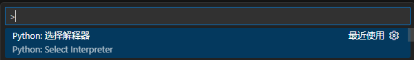

# YJKAPI 8.0👋

#### 介绍 📚
盈建科新版python API 8.0


#### 使用方式 🚀

> ❕ 为了方便与主软件的兼容和支持Agent智能建模自定义工具函数，YJKAPI将被集成在软件安装环境中，不再提供单独的安装包。
1. **配置python环境**:
   - 安装8.0版本软件
   - 将SDK目录下的8.0.rar压缩包解压并复制到安装目录下，替换文件
   - 打开vscode，选择安装目录的python解释器(Ctrl+Shift+P，输入select interpreter，选择python解释器)，环境中已经安装好了YJKAPI
   
   选择安装目录下的python3.10 解释器

2. **运行YJKAPI案例**:
- **不依赖软件运行时的脚本**，依旧通过YJKAPI编写脚本
   ```python
   from YJKAPI import *
   ...
   ```
- **依赖软件运行时的脚本**，需要打开软件，通过`yjks_pyload`命令执行

3. **安装其他python库(windows)**
- powershell
   ```powershell
   # 浏览python环境
   & "C:\YJKS\YJKS_8_0_0\Python310\python.exe" -m pip list

   # 安装其他python库
   & "C:\YJKS\YJKS_8_0_0\Python310\python.exe" -m pip install -r requirements.txt
   ```
- cmd
   ```cmd
   # 方法1：直接使用引号
   "C:\YJKS\YJKS_8_0_0\Python310\python.exe" -m pip list

   # 方法2：先切换到目录
   cd /d "C:\YJKS\YJKS_8_0_0\Python310"
   python.exe -m pip list

   # 方法3：使用pip.exe
   "C:\YJKS\YJKS_8_0_0\Python310\Scripts\pip.exe" list
   ```

#### 后续开发计划

- [ ] 在软件安装包中集成python310环境和相关文件
- [ ] Agent智能建模自定义工具函数
   - 通过YJKAPI编写自定义工具函数，agent解析工具函数并执行

